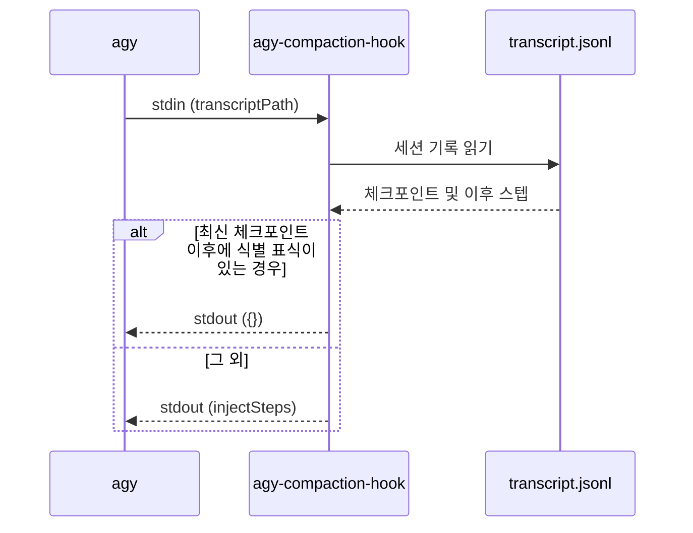

# agy-compaction-hook

`agy-compaction-hook`은 agy 세션의 컨텍스트 압축을 감지하는 Go 바이너리다. 개발 및 검증 전제는 [agy-compaction-hook 개발 문서](../development/agy-compaction-hook.md)에서 다룬다.

## 개요

- agy가 훅 명령으로 실행하는 단일 바이너리다.
- 대화에서 컨텍스트 압축을 감지하고 따르고 있던 스킬과 문서를 다시 읽도록 안내하는 시스템 메시지(재열람 메시지)를 1회 주입한다.
- 1회 실행 시 표준 입력(stdin)에서 JSON 객체 1개를 읽고 표준 출력(stdout)에 JSON 객체 1개를 출력한 뒤 종료한다.

## 지원 환경

- agy CLI, Antigravity IDE, Antigravity App을 지원한다.
  - 세 환경 모두 전역 `~/.gemini/config/hooks.json` 설정을 읽는다.
- 지원 운영체제: Windows, macOS, Linux

## 등록

- `~/.gemini/config/hooks.json`의 `agy-compaction-hook` 항목 아래에 등록한다.
  - 대상 이벤트: `PreInvocation`, `PostInvocation`

```json
{
  "agy-compaction-hook": {
    "PreInvocation": [
      { "type": "command", "command": "<absolute path of the binary>" }
    ],
    "PostInvocation": [
      { "type": "command", "command": "<absolute path of the binary>" }
    ]
  }
}
```

- 바이너리는 인자를 받지 않으며 두 이벤트 모두에서 동일하게 동작한다.

## 실행 흐름



1. 표준 입력(stdin)에서 `transcriptPath`를 읽는다.
2. 세션 기록 파일(`transcript.jsonl`)을 한 줄씩 읽는다.
   - JSON으로 파싱되지 않는 줄은 건너뛴다.
3. `type`이 `CHECKPOINT`인 마지막 스텝(최신 체크포인트)을 찾는다.
   - 체크포인트가 없으면 `{}`를 출력한다.
4. 최신 체크포인트 이후에 위치한 스텝을 검사한다.
   - 조건에 부합하는 스텝이 존재하면 이미 처리된 체크포인트로 보아 `{}`를 출력한다.
     - 판정 기준: `"source": "SYSTEM_SDK"`, `"type": "SYSTEM_MESSAGE"`이고 `content`에 식별 표식이 포함된 스텝
   - 조건에 맞는 스텝이 없으면 재열람 메시지를 담은 `injectSteps`를 출력한다.
5. 식별 표식은 재열람 메시지의 첫 줄에 고정 문자열로 포함된다.
   - 체크포인트 스텝, 모델 응답, 도구 실행 결과는 식별 표식 검색 대상에서 제외한다.

## 출력

```json
{
  "injectSteps": [{ "systemMessage": { "systemMessage": "<reload message>" } }]
}
```

- 재열람 메시지 본문 (문구의 원본은 코드에 정의한다)
  - 첫 번째 줄: 식별 표식 `[agy-compaction-hook]`
  - 방금 컨텍스트 압축이 수행되었음을 안내한다.
  - 대화 중 로드하여 현재 따르고 있는 모든 스킬과 기준 문서를 원본 파일에서 다시 읽도록 지시한다.
  - `AGENTS.md`, `GEMINI.md`, 규칙, 에이전트 정의는 시스템 프롬프트에 속하므로 다시 읽을 필요가 없음을 명시한다.

## 오류 처리

- 어떤 오류가 발생하더라도 바이너리는 `{}`를 출력하고 종료 코드 0으로 정상 종료한다.
  - stdin이 JSON이 아니거나 `transcriptPath`가 비어 있는 경우
  - 세션 기록을 읽을 수 없는 경우
- 오류 원인은 stderr에 출력한다.
