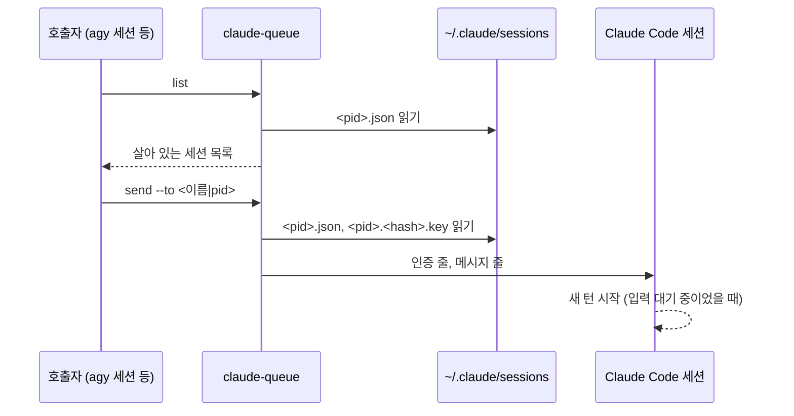

# claude-queue

claude-queue는 같은 호스트에서 실행 중인 Claude Code 세션을 찾아 메시지를 넣는 Go 바이너리다. 세션의 inbox 규약은 [Claude Code 세션 inbox 프로토콜](../reference/claude-code-inbox-protocol.md)을 따르고, 개발 전제는 [claude-queue 개발 문서](../development/claude-queue.md)에서 다룬다.

## 개요



- 호출자는 Claude Code 세션의 자식 프로세스가 아니어도 된다.
- 지원 운영체제: Windows, macOS, Linux

## 하위 명령

### `list`

```text
claude-queue list
```

- 살아 있는 세션을 한 줄에 하나씩 탭으로 구분해 출력한다.
  - 첫 줄은 `NAME`, `PID`, `KIND`, `STATUS`, `CWD` 헤더다.
  - 세션은 이름순으로, 이름이 같으면 pid순으로 정렬한다.
- 세션이 없으면 헤더만 출력한다.

### `send`

```text
claude-queue send --to <이름|pid> [--from <이름>] (--message <본문> | --file <본문 파일>)
```

- `--to`가 10진수이면 pid로, 아니면 세션 이름으로 받는 세션을 찾는다.
  - 이름이 같은 세션이 여럿이면 보내지 않고 실패하며, 후보의 pid와 `cwd`를 stderr에 출력한다.
- `--from`은 받는 세션에 표시되는 송신자 이름이다.
  - 기본값은 `claude-queue`다.
  - 영문 소문자, 숫자, `-`로 이루어진 1자 이상의 문자열이어야 한다.
- 본문은 `--message`와 `--file` 중 하나로만 받는다.
  - 본문은 UTF-8이어야 하며 비어 있으면 안 된다.
- 성공하면 메시지의 `msg_id`를 stdout에 출력한다.

## 세션 판정

- `~/.claude/sessions/` 아래에서 이름이 `<pid>.json`인 파일만 읽는다.
- 아래 조건을 모두 만족하는 세션을 살아 있는 세션으로 판정한다.
  - 등록 파일이 JSON으로 파싱되고 `messagingSocketPath`가 비어 있지 않다.
  - `pid` 프로세스가 살아 있다.
  - 그 프로세스의 생성 시각이 `procStart`와 같다.
    - 생성 시각을 구하지 못했거나 `procStart`가 비어 있으면 이 조건을 건너뛴다.
- 세션 이름은 `name`이고, 비어 있으면 `cwd`의 마지막 경로 요소다.

## 전송 절차

1. 받는 세션의 소켓 경로로 키 파일 이름의 `<hash>`를 계산한다.
2. `~/.claude/sessions/<pid>.<hash>.key`가 있으면 `peerToken`을 읽는다.
   - `peerToken`이 32자 소문자 hex가 아니면 보내지 않고 실패한다.
3. 소켓에 접속한다.
   - 경로가 `\\.\pipe\`로 시작하면 Windows named pipe로, 아니면 Unix domain socket으로 접속한다.
4. 키 파일이 있었으면 인증 줄을 보내고, 이어서 메시지 줄을 보낸다.
5. 두 줄을 보낸 뒤 연결을 끊는다.
   - Windows named pipe에서는 받는 쪽이 두 줄을 모두 읽을 때까지 기다린 뒤 끊는다.

- 접속부터 연결을 끊기까지 10초를 넘기면 실패한다.

### 메시지 줄의 값

| 필드              | 값                                                                 |
| ----------------- | ------------------------------------------------------------------ |
| `msg_id`          | 무작위 UUID v4                                                     |
| `from`            | `--from` 값                                                        |
| `message.content` | `<cross-session-message>` 요소. `from`과 `from-name`은 `--from` 값 |
| `from-mode` 속성  | `prompting`                                                        |

- 본문에 들어 있는 `</cross-session-message`는 `<\/cross-session-message`로 바꿔 넣는다.
- JSON은 HTML 문자를 escape하지 않고 직렬화한다.

## 종료 코드

| 코드 | 뜻                             |
| ---- | ------------------------------ |
| 0    | 성공                           |
| 1    | 오류. 원인을 stderr에 출력한다 |
