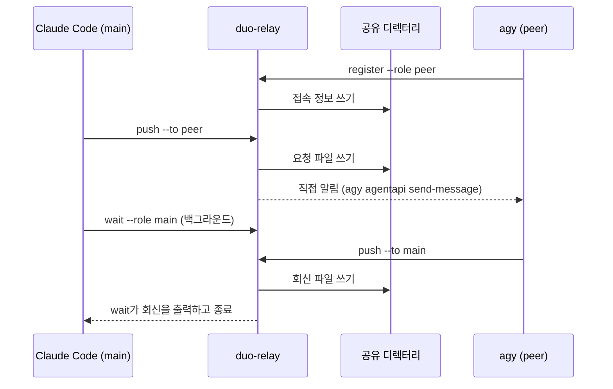

# duo-relay

duo-relay는 [duo-relay 요구사항](../requirements/duo-relay.md)을 구현하는 Go 바이너리다.

## 지원 범위

- Claude Code 세션이 주 세션(`main`)을, agy 세션이 peer 세션(`peer`)을 맡는 조합 하나만 지원한다.



- agy 세션은 `register`로 접속 정보를 남긴 뒤, 요청을 받을 때마다 직접 알림으로 깨어난다.
- Claude Code 세션은 요청을 보낸 뒤 `wait`를 백그라운드로 실행하고, `wait`가 끝날 때 깨어난다.

## 요구사항 충족 방식

| 요구사항 | 충족 방식                                                                                 |
| -------- | ----------------------------------------------------------------------------------------- |
| FR-01    | 각 세션이 대화형 TUI 안에서 셸 명령으로 duo-relay를 실행한다                              |
| FR-02    | 받는 세션의 CLI에 맞는 [깨우는 방식](#깨우는-방식)으로 새 턴을 시작시킨다                 |
| FR-03    | 두 세션이 공유 디렉터리의 메시지 파일로 본문을 주고받는다                                 |
| FR-04    | `wait`는 백그라운드에서 실행되고, 직접 알림은 받는 세션의 진행 중인 턴이 끝난 뒤 전달된다 |

## 깨우는 방식

| 방식            | 동작                                                                      | CLI                  |
| --------------- | ------------------------------------------------------------------------- | -------------------- |
| 직접 알림       | 보내는 쪽의 `push`가 받는 세션의 대화에 알림 메시지를 넣는다              | Antigravity CLI(agy) |
| 백그라운드 대기 | 받는 세션이 미리 실행해 둔 백그라운드 `wait`가 메시지를 출력하고 종료한다 | Claude Code          |

- 백그라운드 대기를 쓰는 세션은 `wait`가 끝나면 유휴 상태에서 새 턴을 시작한다.
- 직접 알림을 받는 세션은 `register`로 접속 정보를 공유 디렉터리에 남긴다.
- `push`는 받는 역할의 접속 정보가 있을 때만 직접 알림을 보낸다.

## 지원 환경

- 운영체제: Windows, macOS, Linux
- agy 세션에 직접 알림을 보내려면 `agy` 실행 파일이 `PATH`에 있어야 한다.

## 공유 디렉터리

- 모든 하위 명령은 `--dir <절대 경로>`로 공유 디렉터리를 받는다.
- 디렉터리를 만들고 지우는 일은 duo-relay를 호출하는 쪽이 맡는다.

| 파일                       | 내용                                                | 쓰는 하위 명령 |
| -------------------------- | --------------------------------------------------- | -------------- |
| `endpoint-<role>.json`     | 직접 알림을 받는 세션의 접속 정보                   | `register`     |
| `round-<NNN>-to-<role>.md` | `<role>` 세션에 보내는 `<NNN>` 라운드의 메시지 본문 | `push`         |
| `wait-<role>.pid`          | `<role>` 세션에서 실행 중인 `wait` 프로세스의 PID   | `wait`         |

- `<role>`은 `main` 또는 `peer`다.
- `<NNN>`은 라운드 번호를 세 자리로 맞추고 빈자리를 0으로 채운 값이다(예: `007`).
- 파일은 같은 디렉터리의 임시 파일에 쓴 뒤 이름을 바꿔 완성한다.

## 하위 명령

### `register`

```text
duo-relay register --dir <공유 디렉터리> --role <main|peer>
```

- agy 세션이 셸 명령으로 실행한다.
- `register`는 자기 프로세스가 agy 세션에서 물려받은 아래 환경 변수 셋을 읽어 `endpoint-<role>.json`에 쓴다.
  - `ANTIGRAVITY_CONVERSATION_ID`
  - `ANTIGRAVITY_LS_ADDRESS`
  - `ANTIGRAVITY_CSRF_TOKEN`
- `endpoint-<role>.json`이 이미 있으면 덮어쓴다.
- 셋 중 하나라도 비어 있으면 파일을 쓰지 않고 실패한다.
- 성공하면 대화 ID를 stdout에 출력한다.

### `push`

```text
duo-relay push --dir <공유 디렉터리> --to <main|peer> --round <N> --file <본문 파일>
```

- `<본문 파일>`의 내용을 `round-<NNN>-to-<to>.md`로 쓴다.
  - 같은 이름의 파일이 있으면 덮어쓴다.
- `endpoint-<to>.json`이 있으면 받는 세션에 직접 알림을 보낸다.
  - endpoint의 접속 정보를 환경 변수로 넘겨 `agy agentapi send-message <대화 ID> <알림>`을 실행한다.
  - 알림에는 메시지 파일의 절대 경로를 적는다.
  - `agy`가 실패하면 그 출력을 stderr에 옮기고 실패한다.
- `endpoint-<to>.json`이 없으면 파일만 쓰고 끝난다.

### `wait`

```text
duo-relay wait --dir <공유 디렉터리> --role <main|peer> --round <N> --timeout <초>
```

- 백그라운드 대기로 깨어나는 세션에서 백그라운드 명령으로 실행한다.
- 시작할 때 `wait-<role>.pid`의 프로세스가 살아 있으면 대기하지 않고 끝난다.
- 그렇지 않으면 자기 PID를 `wait-<role>.pid`에 쓰고 `round-<NNN>-to-<role>.md`가 생길 때까지 기다린다.
- 파일이 생기면 그 내용을 stdout에 출력한다.
- `--timeout`으로 받은 시간 안에 파일이 생기지 않으면 타임아웃 안내를 stdout에 출력하고 끝난다.
- 끝날 때는 어느 경우든 자기가 쓴 `wait-<role>.pid`를 지운다.

## 종료 코드

| 코드 | 뜻                                                                       |
| ---- | ------------------------------------------------------------------------ |
| 0    | 성공. `wait`는 메시지를 출력했다                                         |
| 1    | 오류. 원인을 stderr에 출력한다                                           |
| 2    | `wait`가 타임아웃으로 끝났다                                             |
| 3    | 같은 역할의 `wait`가 이미 실행 중이어서 새 `wait`가 대기하지 않고 끝났다 |
